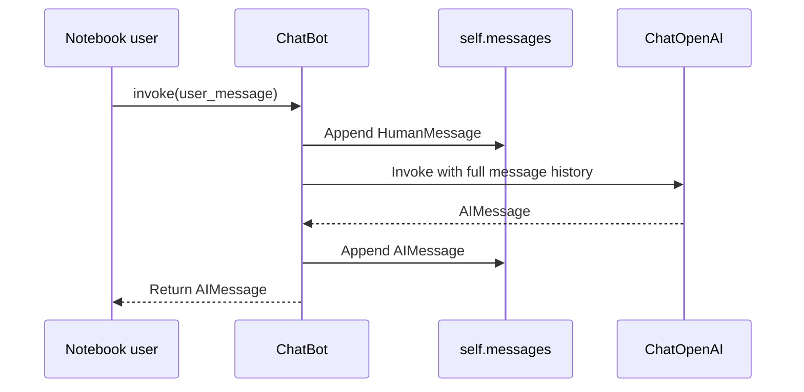

# Technical reference

[Back to README](../README.md)

This reference describes the current [solution notebook](../L2_solution_exercise_01_chatbot_application.ipynb). `ChatBot` is defined inside the notebook; there is no importable application package or command-line entry point.

## Dependencies and configuration

| Item | Role |
| --- | --- |
| `langchain` | LangChain dependency declared in `requirements.txt`. |
| `langchain_openai` | Provides the `ChatOpenAI` integration. |
| `langchain_core` | Provides message and prompt classes; installed through the declared LangChain dependencies. |
| `python-dotenv` | Loads local environment variables from `.env`. |
| JupyterLab / `ipykernel` | Notebook tooling installed separately from project requirements. |
| `OPENAI_API_KEY` | Credential read from the environment by the solution's model clients. |

Dependencies have no version pins. The notebooks record Python 3.13.7 in their metadata; this is not a compatibility guarantee for every dependency release.

## `ChatBot` constructor

```text
ChatBot(
    name: str,
    instructions: str,
    examples: List[dict],
    model: str = "gpt-4o-mini",
    temperature: float = 0.0,
)
```

| Parameter | Meaning |
| --- | --- |
| `name` | Stored in `self.name`; does not alter the prompt by itself. |
| `instructions` | System-message text embedded in each formatted example. |
| `examples` | List of dictionaries containing `input` and `output` strings. |
| `model` | Model identifier passed to `ChatOpenAI`. |
| `temperature` | Sampling setting passed to `ChatOpenAI`; support depends on the selected model. |

The constructor creates its own `self.llm`. The standalone `llm` created earlier in the solution notebook is separate and is not used by `ChatBot.invoke`.

## Prompt construction

For each example, `ChatPromptTemplate` formats three messages:

```text
System: instructions
Human:  example["input"]
AI:     example["output"]
```

`FewShotChatMessagePromptTemplate` combines these groups, and `.invoke({}).to_messages()` produces the initial `self.messages` list. Consequently, the system instructions are repeated once per example. With ten examples, the solution starts with 30 messages before any live conversation.

An empty `examples` list also removes the system instructions in this implementation. Provide at least one example to retain the configured personality. A separate, single system message would require a change to the prompt construction.

## `invoke(user_message: str) -> AIMessage`

The solution performs the following sequence:



Use `response.content` to display the reply text. Each successful call appends two messages. After `k` successful calls with `n` examples, the list contains `3n + 2k` messages, assuming no manual changes or failed calls.

## State and failure behavior

History belongs to a single chatbot instance and lives only in the notebook kernel's memory. Recreating the instance rebuilds the example messages; restarting the kernel removes all in-memory state.

The class appends the user message before calling the API. If that call raises an exception, the user message remains in history without an assistant response. Retrying `invoke` with the same text appends another user message. The class does not implement rollback or application-level error handling.

There is no history truncation or summarization. Longer sessions send more context and can eventually exceed the chosen model's limits. Few-shot examples are included on every request as part of that history.

## Starter and solution differences

| Area | Starter | Solution |
| --- | --- | --- |
| API key | Explicit placeholder in the model constructor | Loaded through `load_dotenv()` and the environment |
| `invoke` | TODO; returns `None` | Stores user and assistant messages and returns the reply |
| Examples | Two examples with a TODO to add more | Ten BEEP-42 examples |
| Demonstration | Four calls requiring completed TODOs | Four implemented model calls |

## Scope

The current implementation demonstrates prompt construction and conversational state. It does not include LangGraph nodes, graph edges, checkpointing, tool execution, retrieval-augmented generation, persistent storage, streaming, or an application UI.
